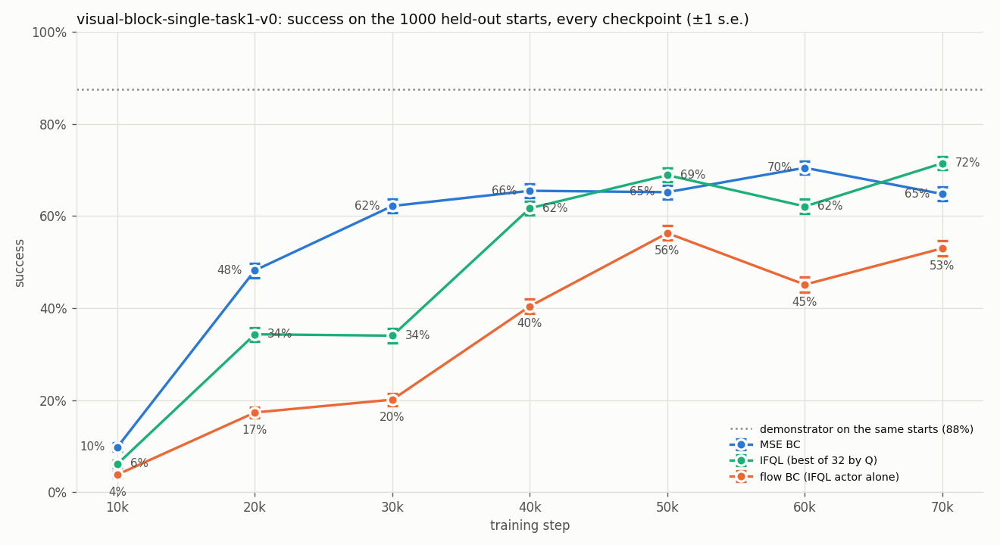

# il-experiment

Behavior cloning vs. offline RL for robot manipulation from pixels, on [OCBench](https://github.com/seohongpark/ocbench).

A UR5e arm picks up cubes and places them at goal positions. It sees only images from three cameras
(front, side, wrist; 224×224) and outputs 25-step action chunks. Three policies are compared:

| | how it is trained | how it acts |
|---|---|---|
| **MSE BC** | CNN + residual MLP regressing the demonstrator's 25×7 action chunk | one deterministic chunk |
| **IFQL** | flow-matching actor + IQL critic Q(s, chunk) and value V(s) | samples 32 chunks, runs the one with the highest Q |
| **flow BC** | the IFQL actor on its own | samples 1 chunk |

All three are PyTorch implementations written for this project. They share one image encoder (IMPALA-small,
shared across cameras) and train for 70k steps. Every checkpoint is evaluated from the **exact first states of
the 1,000 held-out validation episodes**, so models and the scripted demonstrator are compared on identical
starting layouts.

## Results: one cube (`visual-block-single-task1-v0`)

Success rate on the 1,000 held-out starts (±1.5 points):

| | 10k | 20k | 30k | 40k | 50k | 60k | 70k |
|---|---|---|---|---|---|---|---|
| MSE BC | 10% | 48% | 62% | 66% | 65% | **70.5%** | 65% |
| IFQL (best of 32) | 6% | 34% | 34% | 62% | 69% | 62% | **71.5%** |
| flow BC | 4% | 17% | 20% | 40% | **56%** | 45% | 53% |
| demonstrator | | | | | | | 87.6% |



- **BC and IFQL tie at about 70%.** BC gets there much sooner (62% by 30k steps).
- **The critic helps.** Picking the chunk with the highest Q adds 8–25 points over IFQL's own actor from 20k steps on.
- **Missed grasps explain the gap to the demonstrator.** The models fail to lift the cube in 16–24% of
  episodes, against 0.5% for the demonstrator. Once a cube is lifted, they succeed about as often as the demonstrator.

The full write-up, with failure categories, Q-value analysis and action error, is in
[plots/SINGLE_CUBE_RESULTS.md](plots/SINGLE_CUBE_RESULTS.md).

### Caveats

Each model is a single training run (seed). IFQL trained on 60 of the 100 data shards with batch size 128,
against all 100 shards and batch size 256 for BC, because of RAM limits.

## Repository layout

```
ocbench/                      OCBench, vendored from seohongpark/ocbench, plus the code for this project
  impls/agents/
    bc_torch.py               MSE BC
    ifql_torch.py             IFQL (flow BC = its actor with 1 sample)
    ppo_bc_torch.py           PPO + BC fine-tuning (only partly run, no result)
    bc_utils.py               data loading, shard rotation, action normalizer, evaluation
    eval_heldout.py           roll out checkpoints from the 1,000 held-out starts
    eval_action_error.py      distance from the demonstrator's actions on held-out states
    dataset_grasp_stats.py    demonstrator statistics on the held-out episodes
    heldout_videos.py         videos on held-out starts, named by outcome
    plot_*.py                 figures
  impls/run_heldout_analysis.sh   held-out evaluation + figures for one cube
  impls/checkpoints/          per-run results: eval.csv, metrics.csv, train.log, rollout .npz, videos
    analysis/heldout/         one-cube held-out results (summary.txt, action_error.csv, per-run .npz)
setup.sh                      end-to-end pipeline for two cubes: download, train, evaluate, plot
plots/                        figures and the one-cube write-up
train.py, eval_hopper.py,     early sanity check: MLP behavior cloning on Minari Hopper
model.py, policy.py
```

Model checkpoints (`*.pt`, 0.6–3.8 GB each) and the two largest logs are not in the repo, because GitHub limits
files to 100 MB.

## Reproducing

Install the vendored OCBench with its GPU (MJWarp) dependencies, following [ocbench/README.md](ocbench/README.md),
then install PyTorch. The scripts expect one GPU and about 125 GB of RAM. Datasets are downloaded to
`~/.cache/ocbench/datasets`.

**One cube:**

```bash
cd ocbench/impls
python agents/bc_torch.py                  # defaults: single cube, all 100 shards, 70k steps
python agents/ifql_torch.py                # defaults: single cube, 60 shards, best of 32
# point BC= and IFQL= in run_heldout_analysis.sh at the new run directories, then:
bash run_heldout_analysis.sh               # held-out eval of every 10k checkpoint + figures in plots/heldout/
```

Training settings can be overridden with `--set key=value ...`, for example `--set num_steps=30000 num_shards=10`.

**Two cubes**, in one script that skips finished stages and resumes interrupted training (about 30 hours in total):

```bash
bash setup.sh 2>&1 | tee setup_double.log
```
